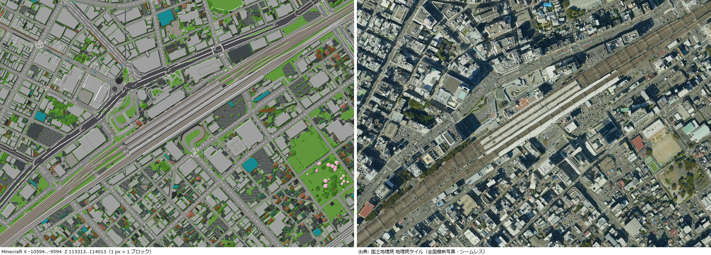
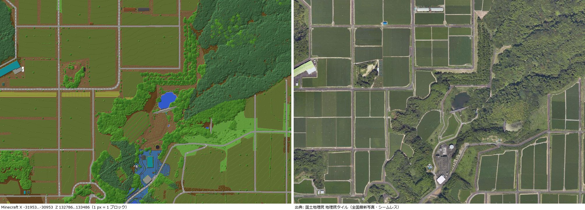
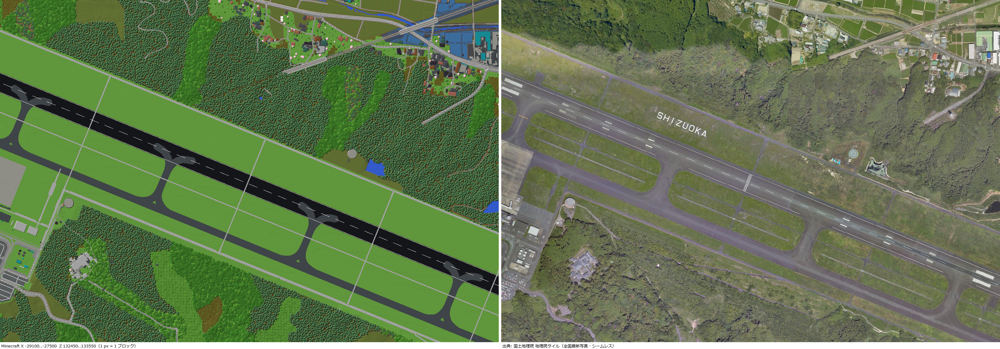
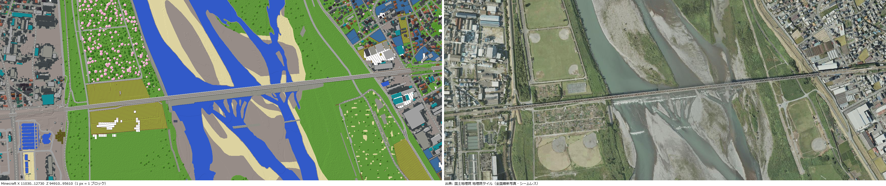
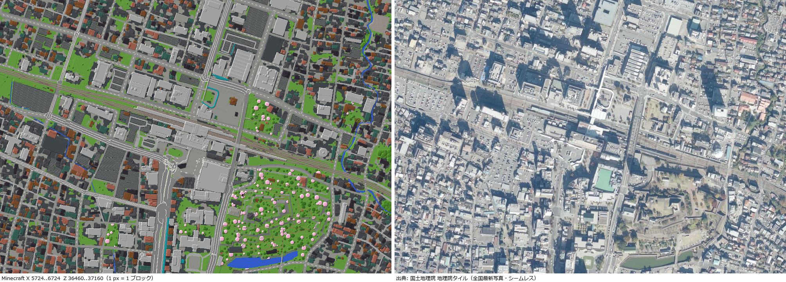

# Japan 1:1 Minecraft World (1 block = 1 m)

**English** | [日本語](README.ja.md)

Shizuoka and Yamanashi prefectures together with Tokyo, Kanagawa, eastern Aichi and their surroundings, rebuilt at
**1 block = 1 m** for **Minecraft Java Edition 1.21.11** from the 1 m elevation data of the Geospatial Information
Authority of Japan (GSI) and open data for roads, railways, buildings and vegetation.

- Area: latitude 34–36°N, longitude 137–140°E (about 270 km × 220 km, sea included)
- About 1 TB in total — **download only the area you want, tile by tile (about 10 km square)**
- 🗾 **[Tile selector](https://ikuto32.github.io/japan-1to1-minecraft/tiles.html)** · 🧭 **[Teleport command maker](https://ikuto32.github.io/japan-1to1-minecraft/teleport.html)**



## What is in it

| | |
|---|---|
| Terrain | GSI 1 m / 5 m digital elevation models (JGD2024). The summit of Mt. Fuji is at 3,775 m (Y 2015); the world height is extended to Y -2032…2031 |
| Roads | Real position and width. Expressways, national, prefectural, local and narrow roads and sidewalks have distinct surfaces, with lane markings, crossings and planted medians. Slopes use half-block steps, so you can walk them without jumping |
| Trails | Mountain and hiking trails (all four Mt. Fuji routes — Yoshida, Subashiri, Gotemba, Fujinomiya — and the crater rim), forest and farm roads |
| Bridges & tunnels | Bridges span valleys and rivers (with piers and parapets); city viaducts, elevated stations and urban expressways stand at their level, subways run underground and mountain tunnels inside the mountains without cutting them. The whole road and rail network is solved at once, so junctions, stations and interchanges meet smoothly |
| Railways | Shinkansen (slab track), JR and private lines with rails; station platforms with tactile strips and roofs |
| Buildings | About 16 million. PLATEAU 3D city models (150 municipalities, LOD2 roof shapes) and GSI building outlines. Walls, windows and roofs differ by use; every storey has a floor and you can walk in |
| Land use | Rice paddies, fields, tea plantations (rows), orchards, greenhouses, solar farms, airports (runway markings), ports, dams, parks, cemeteries, parking lots… |
| Vegetation | Species, density, height, undergrowth and biome for about 350 plant communities of the national vegetation map; no tall trees above the tree line. In Shizuoka, 89 million planted cedars and cypresses at their measured (airborne LiDAR) positions and heights, and point-cloud canopies around Shizuoka Station and Makinohara |
| Sea floor | The GSI 1 m DEM's own sea bed where it has one (airborne laser bathymetry along some coasts, dredged docks), elsewhere ETOPO 2022 (15″ grid) eased in from the coastline; ports and canals are harbour-deep (3–12 m) off their quays, where the coarse grid shows land; what lies deeper than the bottom of the world (about 270 m) is cut flat |
| Lakes | The Fuji Five Lakes and Lake Ashi have their surveyed depths (Lake Motosu: 121 m); other lakes and rivers shelve from the banks |
| In-game tools | A data pack is included: `/function jp:menu` for landmarks, an elevation and latitude/longitude display and more ([below](#in-game-menu-data-pack)) |

<table>
<tr><td></td><td></td></tr>
<tr><td>Makinohara tea plantations</td><td>Mt. Fuji Shizuoka Airport</td></tr>
<tr><td></td><td></td></tr>
<tr><td>Tokaido Shinkansen Fujikawa Bridge</td><td>Around Kofu Station</td></tr>
</table>

(Left of each image: the world drawn from above; right: the GSI aerial photo of the same area. More in [docs/check](docs/check).)

## Requirements

- **Minecraft Java Edition 1.21.11** exactly (other versions cannot open it or break the terrain height)
- Disk: about 0.03–1.7 GB per tile once unpacked (sea tiles are small); about 970 GB for everything
- 4 GB or more of memory for Minecraft. The world is 10× taller than normal, so a render distance of 8–12 chunks is recommended

## Download and install

1. Open the **[tile selector](https://ikuto32.github.io/japan-1to1-minecraft/tiles.html)** and click the squares (tiles) you want
   (preset buttons and Shift-drag area selection are there too).
2. Copy the command shown on the page and run it:
   - **Windows**: open "PowerShell" or "Command Prompt" from the Start menu and paste it
   - **macOS / Linux**: paste it into a terminal

   ```powershell
   curl.exe -L -o download.ps1 https://github.com/ikuto32/japan-1to1-minecraft/releases/download/v1.0.0/download.ps1
   powershell -ExecutionPolicy Bypass -File download.ps1 -Tiles x-20480_z112640,x-10240_z112640
   ```
   ```bash
   curl -LO https://github.com/ikuto32/japan-1to1-minecraft/releases/download/v1.0.0/download.sh
   bash download.sh x-20480_z112640 x-10240_z112640
   ```
   This creates the folder `japan_dem_1m` in your Minecraft `saves` folder (on Windows `%APPDATA%\.minecraft\saves`).
   Use `-Dest D:\minecraft\saves` (macOS/Linux: `-d folder`) to put it elsewhere.
3. Start Minecraft 1.21.11 and open "日本 1m DEM（静岡・山梨とその周辺）" in Singleplayer. You spawn on the summit of Mt. Fuji.

- **Adding tiles later**: run the same command with the new tiles. Tiles you have are skipped and `level.dat`
  (your player, inventory and settings) is never overwritten.
- `japan1m_base.zip` (about 15 MB, always downloaded) holds the world settings, the data packs and about 1.5 km square
  around the summit of Mt. Fuji: the spawn has ground even without the Mt. Fuji tiles, and adding those tiles later keeps
  what you built at the spawn.
- The scripts check the SHA-256 of every zip and resume interrupted downloads when run again.
- **Manual download**: get `japan1m_base.zip` and the tile zips from the [release page](https://github.com/ikuto32/japan-1to1-minecraft/releases/latest),
  create a folder `japan_dem_1m` in `saves` and unpack them all into it (tile zips contain `region/r.*.mca`).
- A tile's ID is the Minecraft coordinate of its north-west corner (`x-10240_z112640` covers X -10240…0, Z 112640…122880).

## Playing

### Coordinates

| | |
|---|---|
| Directions | X is east, Z is south, 1 block = 1 m (36°N 138.5°E is X = 0, Z = 0) |
| Height | Ground at elevation h m is the block Y = -1760 + h. Sea level is Y -1760, the summit of Mt. Fuji Y 2015 |
| Projection | Lambert conformal conic (GRS80, standard parallels 30°N and 40°N, origin 36°N 138.5°E) |

The **[teleport command maker](https://ikuto32.github.io/japan-1to1-minecraft/teleport.html)** converts between latitude/longitude and game
coordinates: click the map or search a place name to get `/function jp:goto {x:…,z:…}` (lands on the surface) or
`/tp @s X Y Z`; enter the coordinates from the F3 screen to see where you are on the map.

### In-game menu (data pack)

Type **`/function jp:menu`** in chat for a clickable menu (Japanese / English).

| Command | What it does |
|---|---|
| `/function jp:menu` | The menu |
| `/function jp:places` | 44 landmarks (Mt. Fuji summit and 5th stations, Tokyo Station, Tokyo Tower, Skytree, Shizuoka, Kofu, Enoshima, Hakone, Izu…) |
| `/function jp:goto {x:-10094,z:113663}` | Land on the top block at X, Z |
| `/function jp:surface` | Drop onto the top block below you |
| `/function jp:hud` | Show elevation and latitude/longitude (to about 30 m) above the hotbar (on/off) |
| `/function jp:nv` | Night vision (on/off) |
| `/function jp:day` / `jp:time_normal` | Stop time at midday with clear weather / let it run again |
| `/function jp:step` | Walk up 1-block steps without jumping (on/off) |
| `/function jp:fall` | Fall damage (on/off) |
| `/function jp:elytra` | An elytra and 64 rockets for long trips |

If you try to go to a tile you have not downloaded, the data pack commands cancel the move or send you back to spawn (the summit of Mt. Fuji).

### Tips

- Chunks with buildings, roads or trees get their lighting computed by the game when first loaded, so they may look dark for a moment.
- Above about 2,950 m Mt. Fuji is snow; above the tree line (about 2,500 m) it is rock and scree.
- Rice paddies are shown flooded, with rows of seagrass as the rice.

## Known limitations

- Building interiors are simple: floors and an entrance, no walls or stairs inside. Heights of buildings outside PLATEAU cities are estimated.
- Roads and railways missing from OpenStreetMap are not there. Where the GSI road edges are missing, roads have the standard width of their class.
- Suspension and truss bridge superstructures and complex interchanges are simplified; undersea tunnels are not drawn. The heights of
  viaducts and depths of subways follow the OSM `layer` (e.g. layer -3 ≈ 24 m deep), not surveyed values.
- The sea floor has the resolution of ETOPO 2022 (about 460 m); depths beyond about 270 m are flattened. Harbour depths are estimated from the shore (quays), not charted.
- The vegetation and land-cover maps can be older than today's land use.
- Tree heights come from point clouds only in Shizuoka (elsewhere: typical heights per plant community).

## Sources and licences

The world was made by processing the data below. If you redistribute or publish the world, include
[`ATTRIBUTION.md`](assets/ATTRIBUTION.md) (it is also in the world folder).

| Data | Provider | Licence / terms |
|---|---|---|
| Fundamental Geospatial Data (elevation, basic items), lake bathymetry | Geospatial Information Authority of Japan (国土地理院) | GSI content terms of use (use and redistribution with attribution) |
| 3D city models (Project PLATEAU) | MLIT (国土交通省) | CC BY 4.0 compatible |
| OpenStreetMap | © OpenStreetMap contributors | ODbL 1.0 |
| 1:25,000 vegetation map (2024) | Ministry of the Environment, Biodiversity Center (環境省) | Use and redistribution with attribution |
| High-resolution land use and land cover map (2024, v25.04) | JAXA | Use with attribution; **commercial use requires prior notice to JAXA** |
| Forest resource analysis data, VIRTUAL SHIZUOKA point clouds | Shizuoka Prefecture (静岡県) | Public Data License 1.0 / CC BY 4.0 |
| ETOPO 2022 15 Arc-Second Global Relief Model (sea floor) | NOAA National Centers for Environmental Information | Public domain (U.S. government work); cite doi:10.25921/fd45-gt74 |

- **OpenStreetMap (ODbL)**: the world is a "Produced Work" under the ODbL. Credit "© OpenStreetMap contributors" and state
  that the data is available under the ODbL (https://www.openstreetmap.org/copyright). OSM is not used for buildings.
- GSI Fundamental Geospatial Data are basic survey results under the Japanese Survey Act; publishing them as a map may need
  approval (publishing as a game world is widely considered not to need it).
- The aerial photos in the check images are GSI tiles (全国最新写真・シームレス).
- Source code (the `jpdem` tool, `tools/`, the download scripts, the web pages in `docs/` and the data pack):
  [MIT License](LICENSE). It covers the code only — the world itself, the aerial photos in the check images and the
  other data follow the terms above.

## Building the world yourself

The Rust tool `jpdem` builds the world from the GSI elevation data and the open data. Data layout, every step, timings,
verification and adding areas are documented in Japanese in **[BUILDING.ja.md](BUILDING.ja.md)**.

```powershell
cargo build --release
pwsh -File build_all.ps1          # elevation -> heightmaps -> roads, buildings, vegetation -> world (about 2–3 h on 32 threads)
python tools/gen_datapack.py      # the in-game tools data pack (assets/datapacks/japan_tools)
```

The vegetation / land use → block mapping is adjustable in `config/landcover_map.csv` (BUILDING.ja.md §11.2).

## Making a release (for maintainers)

1. `python tools/set_repo.py OWNER/REPO` points `release.json` and the links in both READMEs at your repository (the tag is `tag` in `release.json`).
   Then `python tools/gen_datapack.py` puts the link to the web pages into the in-game menu.
2. `python tools/package_release.py --out D:\release` writes one zip per tile (each under 2 GiB), `japan1m_base.zip`, the
   manifests (`tiles.tsv`, `tiles.json`) and the download scripts (about 355 GB in total), and updates `docs/data/tiles.json`.
   Add `--from-build` to rebuild each tile before zipping it, if the world folder has been played in (about 2 hours on
   32 threads; each tile built at the same time needs about 6 GB of memory, lower `--jobs` if that is too much).
   An interrupted run continues where it stopped when you run the same command again, and after changing the repository
   or tag a re-run keeps the tile zips and only remakes the base zip, the manifests and the scripts.
3. Run `upload.ps1` from the output folder (GitHub CLI: `gh release create` / `gh release upload`).
4. Publish GitHub Pages from the `/docs` folder of `main` to get the tile selector and the teleport command maker.
